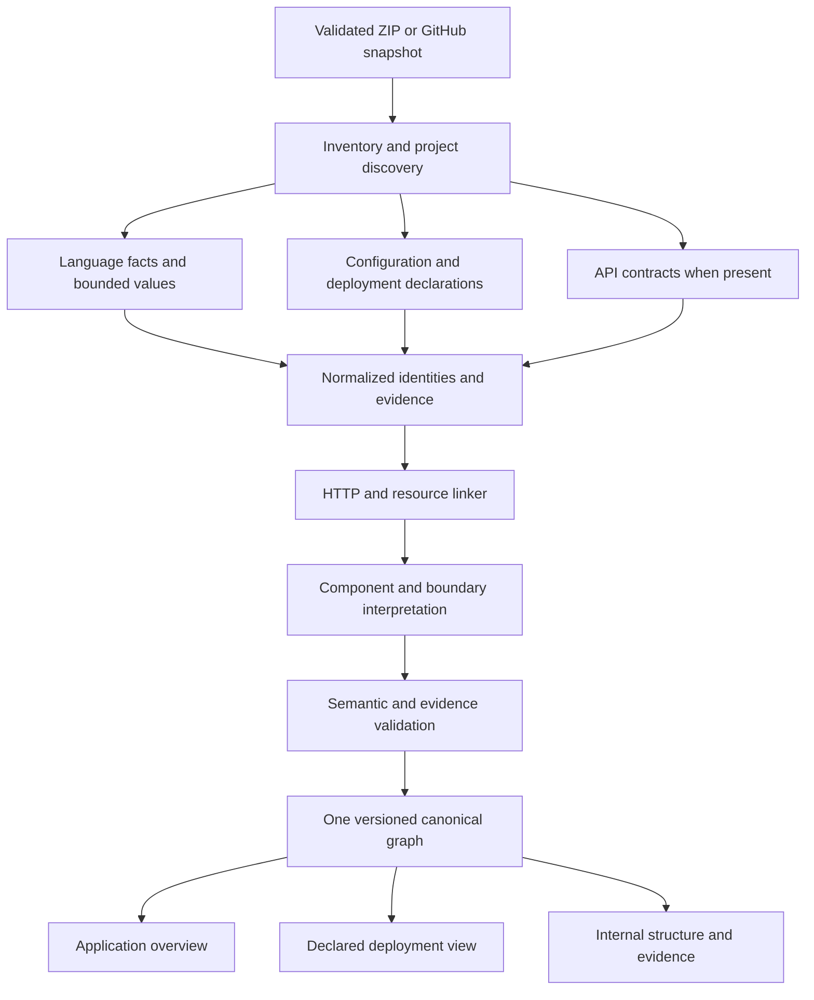

# Deterministic repository-to-architecture reconstruction: selected solution

Research and design date: 1 November 2026.

## Decision

Extend the existing TypeScript compiler worker and Python pipeline into an **evidence-driven architecture reconstruction engine**. Add bounded value/configuration analysis, explicit cross-source linking, and a deterministic architecture interpretation stage. Keep one canonical graph and the existing renderer. No AI model is required.

The first supported vertical is JS/TS applications using Next.js or Express, selected HTTP/database/storage clients, and existing Compose/Wrangler configuration. This is the first implementation scope, not the long-term language limit. A repository without deployment definitions still receives an application view; missing infrastructure is not synthesized.

No application code, dependencies, contracts or saved analyses were changed for this research. No candidate tool or target application was executed. No candidate-tool performance or containment benchmark is claimed. Existing source/tests were inspected; prior synthetic findings were consulted rather than rerun. External repository material was read as reference, not instructions.

## 1. Research findings that drive the design

These are findings from the sources; subsequent algorithms and module boundaries are our proposed design, not claims of demonstrated performance.

| Primary source studied | Relevant finding and scope | Decision for this product |
|---|---|---|
| [Architecture recovery comparison, journal publication (2025)](https://link.springer.com/article/10.1007/s10664-025-10686-2), also [preprint](https://arxiv.org/html/2412.08352v1) | Identifies 13 tools; nine were compared. Deployment parsing and deeper source analysis complement one another. Folder-based service heuristics and implementation flaws cause false positives. Reproduction difficulties limit direct adoption. | Combine techniques inside our engine; do not chain whole research tools. Do not transfer dataset scores to our platform. |
| [The Microservice Dependency Matrix (2023), method and limitations](https://arxiv.org/html/2309.02804v1) | Separates endpoint extraction, outbound-call extraction and matching; also studies data dependencies. Its prototype targets Java/Spring. Name/field similarity is approximate, and asynchronous communication is outside its evaluated approach. | Implement a typed linker for our supported stacks. Strengthen matching with destination/configuration scope. Shared shapes do not prove shared resources. |
| [Layer recovery using ego networks (2021), method and validity](https://arxiv.org/html/2106.03040) | Infers layers from dependency neighborhoods and merges them. Evaluation is Java/closed-layer focused, with generalization and ordering questions. | Use dependency structure to organize presentation; do not assume every app is a closed layered architecture or make clusters services. |
| [LLVM/Clang data-flow introduction](https://clang.llvm.org/docs/DataFlowAnalysisIntro.html) | Explains abstract value domains, control-flow propagation, joins and fixpoints. | Adapt these established concepts to a bounded JS/TS analysis. Do not integrate the C++ analyzer into TS analysis. |
| [Code2DFD project](https://github.com/tuhh-softsec/code2DFD), [entry](https://raw.githubusercontent.com/tuhh-softsec/code2DFD/main/code2DFD.py), [orchestrator](https://raw.githubusercontent.com/tuhh-softsec/code2DFD/main/core/dfd_extraction.py) | Technology-specific extraction and traceability are useful patterns. Inspected orchestration performs repository preparation/checkout through PyDriller. | Borrow the architecture pattern, not its ingestion/runtime wholesale. Retain our immutable ZIP snapshot pipeline. |
| [MicroDepGraph](https://github.com/clowee/MicroDepGraph) | Analyzes local Java microservice projects and Docker configuration; exports graph/image formats. | Reference for configuration/service linking, not a general JS/TS replacement. |
| [Knip plugin documentation](https://knip.dev/explanations/plugins), [Next plugin source](https://raw.githubusercontent.com/webpro-nl/knip/main/packages/knip/src/plugins/next/index.ts) | Contains framework entry conventions. Documentation explicitly includes dynamic configuration loading in some plugin paths. | Maintain platform-owned static entry rules inspired by documented patterns; never execute client configs to obtain entries. |
| [TypeScript Compiler API](https://github.com/microsoft/TypeScript/wiki/Using-the-Compiler-API) and locally installed TypeScript 5.9.3 declarations | Provides programs, configuration parsing and module resolution. Installed API includes `getParsedCommandLineOfConfigFile`, `parseJsonConfigFileContent` and `resolveModuleNameLiterals`. | Extend the current pinned compiler/custom host. Audit options and filesystem boundaries. |
| [Node package semantics](https://nodejs.org/api/packages.html), [pnpm workspace configuration](https://pnpm.io/pnpm-workspace_yaml) | Package entry/exports conditions and workspace membership are explicit inputs to resolution. | Resolve per supported runtime/compiler context, not package-name-to-folder guessing. Do not apply a newer runtime's semantics blindly to an older target. |
| [OpenAPI 3.1.1](https://spec.openapis.org/oas/v3.1.1.html), [Compose specification](https://compose-spec.github.io/compose-spec/spec.html), [Kubernetes Service](https://kubernetes.io/docs/concepts/services-networking/service/) | Describe API contracts, deployment configuration and service selection; they are not observed runtime execution. | Parse supported declarations with locations; reconcile with source and preserve unsupported/unknown details. |

No study establishes accurate recovery for every possible repository. The first three papers are scoped evidence for methods, not proof of universal coverage. The published comparison is preferable to relying only on its older preprint. No findings from the reference image are assumed true of a repository.

## 2. Baseline: what stays and what changes

Relative paths below refer to the current workspace.

| Existing module | Keep | Proposed extension |
|---|---|---|
| `backend/app/ingestion/*`, `jobs.py` | Fixed-host retrieval, ZIP checks, bounded jobs and snapshot cleanup | Stage timings and eventually OS-enforced containment; no Git clone/build requirement |
| `backend/workers/typescript/index.cjs` | Compiler host, declarations, local-body calls, evidence | Split discovery, project resolution and abstract-value logic into trusted worker modules |
| `workers/typescript/adapters/*` | Framework-specific interpretation | Versioned capabilities, explicit runtime context, negative fixtures |
| `backend/app/analysis/configuration.py` | Bounded source-marked YAML processing | Selected Compose fields needed for source/resource linkage; preserve profiles |
| `backend/app/evidence/*`, `contracts.py` | Reference/range/hash checks and one graph | Derivation validation and explicit status/context semantics through reviewed contract evolution |
| `backend/app/graph/exploration.py` | Bounded exploration, membership and evidence navigation | Consume semantic roles rather than deriving them primarily from paths |
| `backend/app/persistence/store.py` | SQLite and saved snapshots | Measure, cache immutable indexes, normalize storage only if measurements justify |
| `ArchitectureCanvas.tsx` | React Flow and ELK worker | Compound boundaries, typed connectors, deterministic icon/label mapping and export |

Confirmed current gaps include path-based exclusions, missed Next root routes, stale initializer URL tracking, root-only compiler configuration, path-based component roles and whole-graph request indexing. `wrangler.cjs` also keys some deployment/resource identities by names while profile is a separate field; multi-profile reconciliation must not assume equal names mean equal deployed resources.

## 3. Selected tools and custom code

### Production foundation

* Keep TypeScript 5.9.3, Node, Python/FastAPI/Pydantic, SQLite, PyYAML, React Flow and ELK.
* Use standard JSON and the existing compiler JSONC facilities. Reuse existing YAML source marks with strict size/depth constraints for a documented subset.
* Initially implement OpenAPI path/operation extraction from local JSON/YAML without a full generator or remote dereferencing dependency.
* Add no second general JS/TS parser by default.

### Custom code justified by the actual gaps

1. Source classification and entry discovery.
2. Snapshot-contained project/workspace resolution.
3. Bounded control-flow/value analysis and selected library summaries.
4. HTTP/resource relationship linker.
5. Architectural roles, membership and boundary rules.
6. Evidence-chain validation and view selection.

These are reusable internal modules first. Publish/extract a package only after interfaces and multiple use cases stabilize.

### Reference or development-only inputs

* Knip: entry conventions, not a client-config execution path.
* Linguist: classification hints; repository attributes are not trusted exclusion commands. See [upstream](https://github.com/github-linguist/linguist).
* dependency-cruiser: import-edge comparator on equivalent labelled inputs, not truth oracle or default duplicate scan. Explicit platform-owned configuration only. See [options](https://github.com/sverweij/dependency-cruiser/blob/main/doc/options-reference.md).
* Code2DFD/MicroDepGraph and the dependency-matrix work: mechanisms and evaluation design, not direct platform replacement.

### Deferred until a demonstrated need

Syft for separate inventory, NetworkX/community detection for grouping experiments, Joern for a demanded additional-language pilot, ast-grep for selected missing syntax patterns, LikeC4 for optional interchange, and dedicated HCL/Kubernetes/protobuf tooling as those scopes are implemented. No graph database, queue cluster or search service is necessary for the first vertical.

Do not copy external code without checking its pinned source, license and attribution requirements. The inspected Code2DFD LICENSE declares Apache-2.0, but this is not a complete transitive license audit. [License](https://raw.githubusercontent.com/tuhh-softsec/code2DFD/main/LICENSE).

## 4. Proposed pipeline

The graph is a knowledge representation, not an inference engine by itself. All derived claims have explicit rules and inputs. Acyclic rule-stage dependencies keep the first implementation simpler; no general rule engine, Datalog runtime or recursive plugin system is needed.

## 5. Discovery and project resolution algorithm

**Classification:** inventory admissible files before deciding their role. Record `production-supported`, `production-candidate`, `test`, `generated`, `vendor`, `documentation`, `unsupported` and `unknown` with reasons. These are proposed roles, not current schema fields. Do not exclude all `public/`, `scripts/` or `plugins/` code by folder name. Entrypoint reachability improves relevance but is not proof of dead code when the entry detector is incomplete.

Seed entries using supported framework conventions, package entry fields, HTML script references and statically readable configuration. Parse package scripts as text only to identify simple references; never execute them. Include other safe source candidates within budgets. Report the difference between inventoried, parsed and framework-interpreted coverage.

**Projects:** discover tsconfig/jsconfig files and workspace manifests. Use compiler configuration parsing through a restricted host whose reads/globs cannot escape the snapshot or enter target-installed dependencies. Preserve configuration-relative paths, diagnostics, extends/reference cycles and supported version semantics. Classify external config packages as unavailable instead of fetching them.

**Modules:** use cached compiler resolution per project/context. Build a workspace membership map from supported manifest forms. Resolve workspace imports through supported `exports`, `imports`, subpaths and source targets; do not fabricate `src/index.ts` when an absent generated `dist` entry is declared. Honor supported path aliases without assuming they imply runtime bundler configuration. Record conflicting conditions or missing targets.

Start one project at a time. Project references require dependency-aware partitioning; parallelize only after handling cross-project declarations and measuring memory. Cached directory indexes should replace repeated scans of every supplied path in host operations.

## 6. Bounded abstract values: exact first slice

Suggested value kinds: `Unknown(reason)`, literal, symbolic config key, finite alternatives, static object, client identity and structured URL. Each carries source support and completeness/condition information. This is a design, not an implemented guarantee of soundness for all JavaScript.

**Initial supported operations:** immutable local/import aliases; ordered simple assignments; literal/template/concatenated strings; statically named `process.env` keys as symbols; static object literals/properties; selected constructors; small explicitly supported pure helper returns. Imported mutable module state and captured mutable values remain unknown unless ordering is established.

Construct a small explicit control-flow representation for supported statement forms. Define assignment transfer functions and joins. A known-false branch is excluded only when established by the supported evaluator. Otherwise join possible values, including unknown. Loops use deterministic iteration/widening; unsupported writes, dynamic property access, getters, proxies, alias escape or unknown side effects invalidate affected values. Never use the first initializer or last textual assignment as a general answer.

Do not execute expressions, import target modules or evaluate build config. Function summaries are platform-owned or derived only for the supported subset and carry side-effect preconditions. Model cache keys must include function source, context/config and rule versions.

Provisional engineering budgets for a pilot may cap alternative values, helper depth and processed states; set numerical defaults only after measurement. Exceeding a budget yields unknown and coverage diagnostics. Do not silently drop alternatives to obtain a resolved value. Never report actual credential values; track symbolic keys and redact URL userinfo/query secrets before graph publication.

## 7. Framework and client semantics

Framework adapters should expose detection preconditions, supported versions, entry rules, runtime-context rules and capability limitations. Small trusted procedures handle semantic cases; data files can describe patterns but cannot replace binding/control-flow logic.

First extend Next App Router root/nested routes and exports plus Express literal routes/imported handlers. Next pages, router mounts, middleware, server actions, JSX composition and other cases become explicit subsequent capabilities. Browser/server/shared/unknown context must be represented before matching relative HTTP requests. Official route semantics remain the reference. [Next route handlers](https://nextjs.org/docs/app/api-reference/file-conventions/route).

Client models should say which call/argument denotes destination, operation, method and resource. Begin with existing fetch and a narrow supported database/storage client path. Add Axios/ORM/queue patterns only with actual fixtures and demand. Importing an SDK or constructing an unused client does not imply an operation. Unknown external-library bodies remain external, not fake local implementations.

## 8. Linker: destination before endpoint

For each outbound operation:

1. Establish caller ownership, execution context, client identity, method, structured target and supporting expressions.
2. Resolve destination candidates through supported config/service bindings. Restrict Compose names/aliases to project/network/profile context; distinguish internal container port from published host port. Do not confuse browser localhost with container localhost.
3. Search endpoints only inside those candidate destinations. Match method, base path and route-pattern semantics. Preserve regex constraints, catch-all/optional segments and supported precedence. Canonicalizing placeholder names does not make all parameterized routes equivalent.
4. Return a source-supported match when predicates and uniqueness suffice; a conditional/ambiguous candidate set otherwise. Unknown destination stays unknown even when a similar path exists elsewhere.
5. Record source call, configuration path, target route and handler support. Validate the complete derivation, not just nonempty evidence IDs.

Relative `/api/orders` in supported browser context can use established application-origin routing. A server-side relative URL needs its own supported semantics. Rewrites, gateways and proxies are additional evidence stages, not guessed edges. Schema/type similarity can help distinguish candidates but cannot prove destination identity.

OpenAPI describes a contract. Ingest declared method/path/server/operation identity with document scope. Local bounded `$ref` resolution only; remote refs are unresolved. Contract-to-implementation matches need supported context and can disagree; neither silently overwrites the other. A contract alone does not reveal downstream calls.

## 9. Resource and deployment reconciliation

Treat package, client, remote integration, declared resource and deployment as distinct identities. Resource key includes provider/type/address, owning configuration/profile and namespace/module where applicable. Equal names across profiles are not sufficient identity.

Resource usage requires a supported operation on a bound client. Attaching it to a declared instance requires configuration linkage. Compose image family helps classify a resource, not prove use; `depends_on` remains a startup declaration. A Dockerfile establishes a build artifact, not that anything deploys it. Compose build contexts can help locate code but do not uniquely define entry/role without further evidence.

Extend Compose fields incrementally: build context, command/entry declarations as text, ports, environment-key references, network membership/aliases and explicit volumes. Resolve only snapshot-contained referenced files. Keep profiles/overrides separate until merge semantics are implemented; never read host environment implicitly. Existing YAML-alias rejection remains documented until a bounded alias design is implemented.

For Wrangler, connect supported bindings to actual source property/client use and preserve profile-scoped identities. Kubernetes selectors/Ingress references and Terraform addresses come later through dedicated adapters. No image pulls, Terraform operations, remote module fetches or cloud queries are necessary.

Queues eventually match producer/consumer operations through broker identity plus topic/queue/profile, not topic string alone. Matching a shared DTO shape is not a database or message-broker link.

## 10. Deterministic component interpretation

Keep package ownership as an objective hierarchy. Establish logical responsibilities through explicit route handlers, UI entry/context, consumers, scheduled functions and resource operations. Starting from each entry, follow supported local call/module dependencies until another architectural boundary, external operation or shared utility region is reached. Record overlapping/shared participation instead of forcing every function into one artificial service.

Use deterministic ownership tie-breaking for display only. Mixed-role components are permitted. Stable dependency neighborhoods and SCCs can help collapse cycles for presentation; they do not establish deployability. Do not run Louvain over definitions/ownership/type edges and declare its groups services.

Names should be evidence-based generic labels initially, such as HTTP API, browser application, worker, shared contract or storage adapter. Semantic business names can use supported declarations or optional separately labelled user annotations. A static engine cannot always derive a human business concept from arbitrary identifiers.

No new machine-learning model or graph library is required for the initial component pass. Evaluate clustering only if explicit semantic rules plus dependency neighborhoods leave a measurable grouping problem.

## 11. Graph and presentation model

Keep normalized direct facts and derived claims in one canonical analysis result, distinguished by provenance and support. Full raw tool reports, if ever retained, are bounded diagnostics rather than architecture truth. Use proposed logical records for provider run, source fact, architecture claim, derivation and unknown/conflict; schema evolution requires versioning/migration and saved-analysis tests before implementation.

Separate resolution, source/configuration/derived origin, branch/profile conditions and completeness. A statically resolved call can still be conditional. Do not assign uncalibrated confidence percentages. Keep member IDs, source edge IDs and support evidence for aggregates. Derived support graphs should be acyclic and traversable to raw citations.

Provide three projections of the same graph:

* **Application overview:** applications/logical responsibilities/resources/external integrations, typed static relationships.
* **Declared deployment:** explicit workloads/network/resource boundaries; deployment state not observed.
* **Internal structure:** entry-selected functions/classes and dependencies; no runtime sequence claim.

Use compound boundaries/icons/typed arrows to reach the reference image's visual clarity. Show region/VPC/subnet/failover only when declarations support them. Keep supporting systems in expandable groups; avoid a disconnected catalogue of vendor logos. Layer arrangement can follow roles and SCC-condensed dependencies, without asserting the code obeys a closed-layer architecture.

Choose visible nodes by entries, resources and boundary-crossing responsibilities before counts. An initial overview budget around 12–18 logical nodes is a UI hypothesis, not an algorithmic truth. Do not add edges for aesthetic connectedness. Expose omitted counts/detail navigation and meaningful unknowns. SVG/PNG export should consume the same view with canonical-ID/evidence metadata; no second authoritative diagram model.

## 12. Performance and safety

Measure inventory, fingerprinting, config parsing, compiler program creation, extraction, value analysis, linking, interpretation, validation, serialization, SQLite reads, index construction and layout separately. Record elapsed times, input sizes, output counts, budgets and available process-tree memory observations; V8 heap is not total RSS. No enterprise latency or memory target is asserted before measurement.

First optimize repeated host path scans, immutable graph/index reuse and bounded on-demand value analysis. Track cross-project dependency effects before splitting compiler programs. Limit concurrent heavy jobs by measured memory, not processor count alone. Normalized SQLite tables may help queries later; do not migrate solely because the output is a graph.

Incremental correctness needs fact-to-file/rule/config dependencies, deletion/rename invalidation and propagation to callers/derived claims. Cache keys include snapshot/project/compiler/rules/metadata/context. A changed config or exported signature can invalidate many unchanged files. Full-analysis comparison must validate incremental equivalence before rollout. Retain periodic/full fallback.

All client inputs remain inert. Model pulls, package installs, plugin loading, target builds, code execution and unrestricted network/filesystem discovery are prohibited. Current guards are not OS isolation. Enforce process-tree, filesystem, egress and resource boundaries before public multi-tenant uploads. Optional new parsers/providers require pinned source/config/extension audits. This is not a blocker to trusted local development; it is a deployment gate.

## 13. Implementation sequence and acceptance

| Increment | Deliverable | Acceptance |
|---|---|---|
| 1. Repair known failures | Discovery/root-route/value invalidation fixtures and fixes | Saved public-source/root-route cases recovered; stale host absent; all applicable existing regressions pass |
| 2. Resolve supported projects | Restricted tsconfig/workspace resolver and diagnostics | Relative config inheritance, aliases, workspace exports/subpaths, cycles/missing generated targets have labelled outcomes; no out-of-root reads |
| 3. Follow bounded values | Supported control-flow subset, symbolic config and client operations | Reassignment/joins/helper/side-effect negatives behave conservatively; deterministic budgets and support chains |
| 4. Link a complete vertical | Express/Next route → handler → processing → client operation → configured destination | Correct source links; ambiguous/missing config stays explicit; no same-name resource guess |
| 5. Build main architecture | Responsibility/boundary interpreter and revised views | Generic meaningful roles, evidence-preserving drill-down and export; no directory-to-service promotion |
| 6. Evaluate and optimize | Diverse labelled repositories and size series | Accuracy by kind, comprehension findings, stage timing/memory and incremental equivalence recorded |
| 7. Broaden by demand | Another language/framework/config adapter | Same provider/evidence contract, dedicated corpus and explicit unsupported scope |

Instrument from increment 1; performance work is not postponed until increment 6. Each increment is a reviewable code change, not a platform rewrite. Contract changes, if needed, precede publishing new persisted records. No assumption that every proposed external tool will be integrated.

## 14. Concrete first vertical and negative cases

Create a static fixture repository, never run its application:

* Browser entry issues a supported request to an application route.
* Next/Express route binds a handler, which calls an application function.
* The function performs an operation on a supported client.
* A separate configuration declares the client destination and resource.
* Include an unused SDK, a type-only shared schema and unrelated same-named resources.

Expected overview: browser application → HTTP API → processing component → storage integration, with deployment binding where established. Select each arrow to recover original IDs and the whole evidence chain. The internal view can show the actual call dependency path.

| Mutation/test | Expected result |
|---|---|
| Unconditional URL reassignment | Old host absent; replacement only if established |
| Conditional URL alternatives | Conditional alternatives/ambiguity, not one arbitrary host |
| Unknown helper mutates config object | Affected value unresolved |
| Two services expose same route | Destination scope selects or retains ambiguity |
| Browser/server both use relative path | Match only under supported origin/routing context |
| Client constructed but unused | Construction fact, not application data operation |
| Same topic on different brokers | No automatic producer-consumer merge |
| Different profiles reuse resource name | Distinct identities unless explicit equivalence |
| Only Dockerfile present | Buildable artifact, deployment unestablished |
| Production public script | Included or explicitly classified with supported reason |
| Missing generated workspace export | Unresolved with reason, no fabricated source target |
| OpenAPI disagrees with route | Contract discrepancy; no silent resolution |
| Missing IaC | Application view available; no invented cloud topology |

Use GitDiagram as an integration case, not the only corpus or a hand-authored-image oracle. Add a monolith, a workspace app, a small multi-service application and a case without deployment files. Pin snapshots and manually label the supported architecture. [microSecEnD](https://github.com/tuhh-softsec/microSecEnD) is a useful traceable reference dataset but Java-heavy, so not a substitute for our JS/TS evaluation set.

Measure precision and recall by claim kind, unresolved rate separately, scope exclusions and evidence completeness. Precision = supported-correct predictions / evaluated predictions; recall = recovered expected facts / expected facts in defined scope. Do not mix definition/import counts into communication accuracy. Evaluate grouping/boundary quality separately and record disagreements. A held-out repository tests generalization. Human comprehension needs actual unfamiliar readers, not automated clicks.

For the finite labelled fixture set, require all specified positives/negatives and support chains to pass. Do not promise an arbitrary universal 95% accuracy target. Record actual measured public-repository results before setting a release threshold. Source/runtime distinction and no invented deployment remain hard invariants.

## 15. Durable scope

The product can accept diverse repositories while reporting language/framework capability coverage. New ecosystem versions require rule maintenance and versioned fixtures. Public documentation informs maintained rule packs; do not depend on arbitrary live internet search during client scans. External data must be pinned and provenance-recorded before use.

This proposal resolves the architectural direction: **reuse the compiler and safe parsers; build the missing bounded semantic linker and interpretation layer; validate both extraction and the diagram; scale from measured bottlenecks.** The first implementation is small enough to prove end to end, while retaining the extension boundaries needed for broader coverage.
