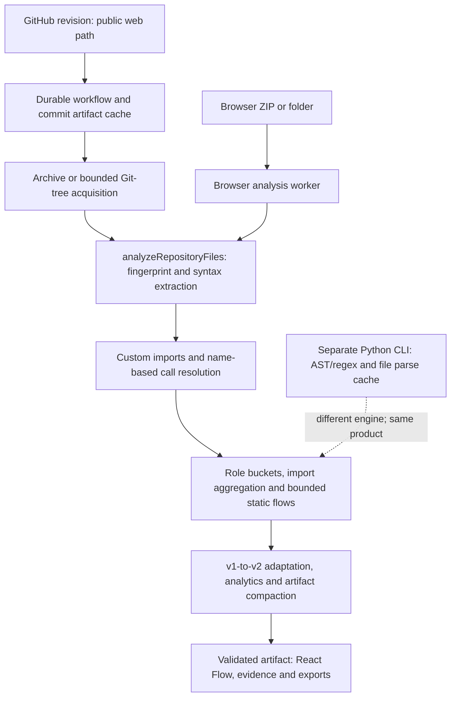
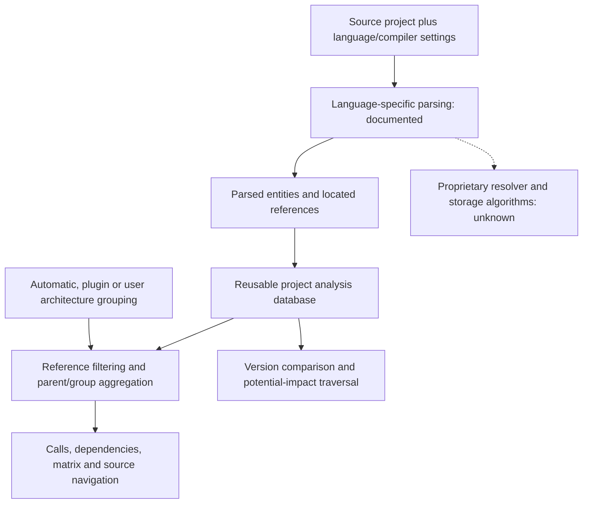
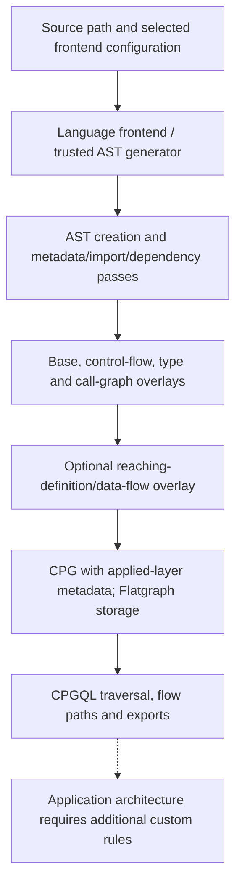
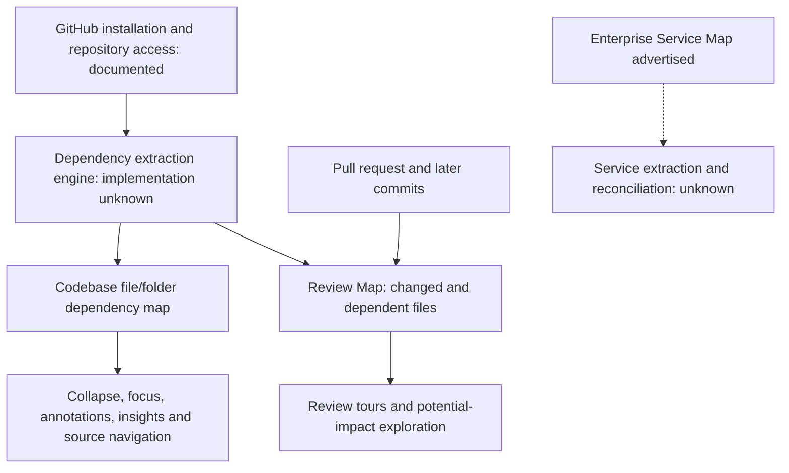
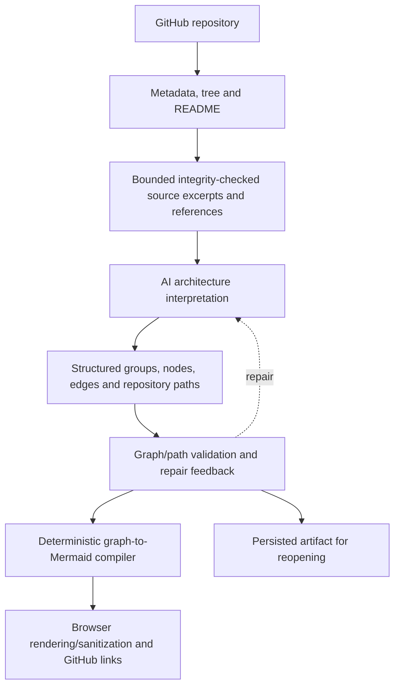
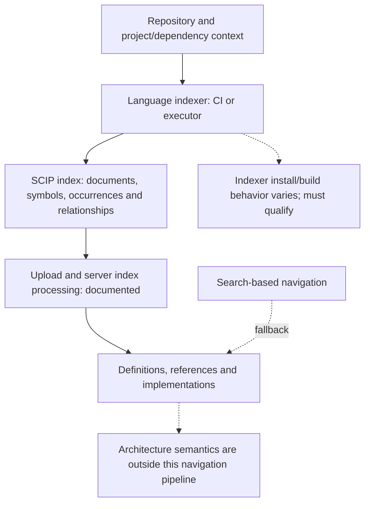
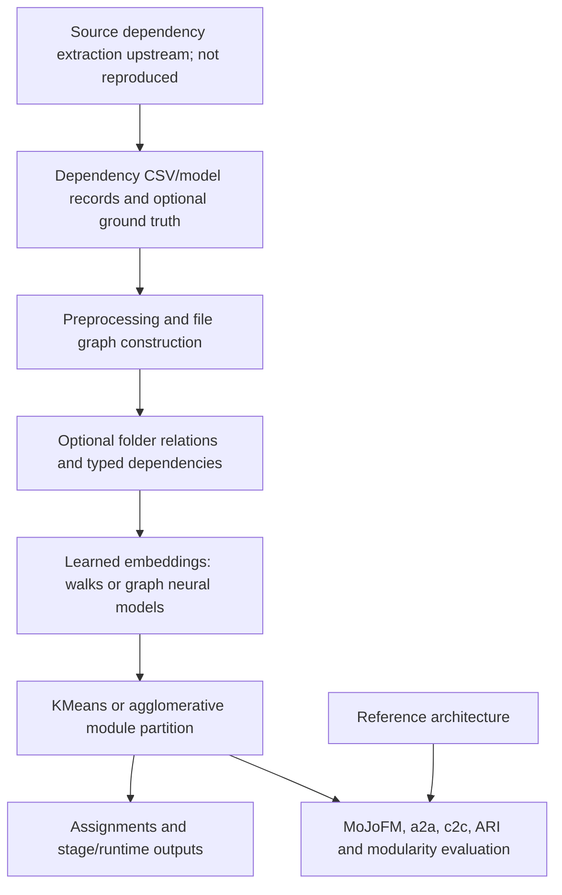

# Workflow diagrams

Date: 2 November 2026. These are source-reconstructed or documented pipelines, not executed traces. Unknown stages are explicit. The linked individual reports explain provenance and limits.

## repodna

[Standalone Mermaid source](workflows/repodna.mmd)

## understand

[Standalone Mermaid source](workflows/understand.mmd)

## joern

[Standalone Mermaid source](workflows/joern.mmd)

## codesee

[Standalone Mermaid source](workflows/codesee.mmd)

## gitdiagram

[Standalone Mermaid source](workflows/gitdiagram.mmd)

## sourcegraph

[Standalone Mermaid source](workflows/sourcegraph.mmd)

## structsar

[Standalone Mermaid source](workflows/structsar.mmd)

