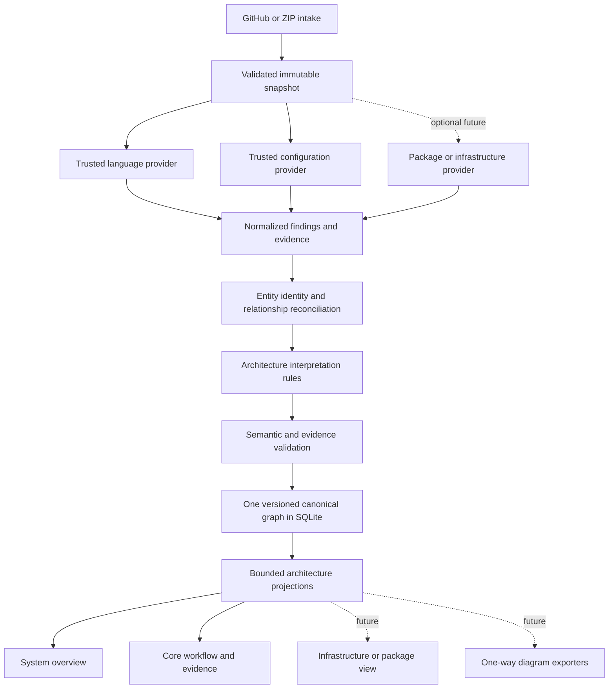

# Revised architecture proposal

Date: 31 October 2026. Proposed evolution of the existing modular monolith; not implemented. Existing canonical/API contracts remain unchanged by this review. See [impact review](architecture-impact-review.md) for tool decisions and [gap assessment](analysis-gap-assessment.md) for implementation evidence.

## Keep the system small

The proposed Architecture Interpretation Engine is useful as a responsibility boundary: it answers how supported code/configuration facts imply architectural roles and connections. It should initially be an internal deterministic Python module, with language-specific value reasoning remaining in the compiler worker. Do not create a microservice, generic workflow platform, plugin marketplace or second database for this stage.

The current engine already performs some interpretation in worker ownership rules and presentation aggregation. Evolve these rules deliberately; do not bolt on an unrelated architecture generator. Keep interpretation rules out of React components and layout code so all views share the same semantics.

## Revised pipeline



Value propagation is an input to interpretation, not a process performed after rendering architectural components. TS/JS bindings, assignments and abstract values belong in the trusted TypeScript worker. Python combines normalized claims across source/configuration providers and applies cross-domain architecture rules. NetworkX clustering, if validated later, supplies optional grouping suggestions after selecting a relevant projection; it must not define canonical service identity.

A simple fixed pipeline is sufficient. Do not add a general cyclic inference loop. Individual bounded analyses can have deterministic fixed points; cross-stage rules should have explicit inputs and dependency ordering.

## Responsibilities and tool roles

| Boundary | Responsibility | Current/future implementation |
|---|---|---|
| Ingestion | Resolve allowed source, extract safely, identify all snapshot bytes | Keep `ingestion/*`, jobs and existing protections |
| Language provider | Declarations, binding, typed source edges, abstract values, language diagnostics | Keep TS Compiler API worker; future isolated Python AST provider |
| Configuration provider | Parse allowlisted data; declarations, references and source spans | Keep/extend `analysis/configuration.py` and framework adapters |
| Package provider | Package coordinates/versions/manifest evidence | Optional future Syft profile; no source-call claims |
| Infrastructure provider | Resource addresses and declared references | Future local HCL provider; Inframap pilot only if provenance survives |
| Normalization | Convert provider locations/types into common internal records | Small platform-owned adapters, no vendor graph exposure |
| Reconciliation | Canonical identities, equivalence, conflicts and evidence merge | Deterministic Python functions |
| Interpretation | Roles, supported resource use and communication, ownership candidates | New internal rule module when implementation is authorized |
| Validation | Structural integrity plus rule-specific semantic preconditions | Retain citation checks; add invariants and derivation checks |
| Projection | Choose scope/detail without changing underlying facts | Evolve `Index`/projection functions |
| Renderer/export | Display/serialize supplied view | Keep React Flow/ELK; optional LikeC4 later |

Not every tool is a provider. dependency-cruiser/Grimp can remain development comparators. import-linter is a policy validator. Checkov produces security diagnostics. NetworkX is an algorithm library. LikeC4 is an exporter/modeling interface. Treating all of these as interchangeable evidence producers would obscure their different semantics.

## Findings, facts and derived claims

The persisted canonical graph should retain normalized source facts **and** supported derived architectural claims, clearly distinguished. Full unnormalized tool reports belong in optional bounded diagnostic artifacts with retention controls, not mixed into graph entities or exposed as architecture by default. Do not retain unnecessary source snippets, credentials or absolute temporary paths.

Proposed logical records, not changes to the current schema:

* **Provider run:** provider/version, engine/rule/config digest, snapshot digest, supported scope, exclusions, budgets, completion/failure and coverage.
* **Evidence:** snapshot-relative file, byte identity, source range with explicit encoding, extraction rule and origin. External metadata needs its own versioned provenance, not a fabricated repository line.
* **Entity:** canonical identity and kind, source declaration/package/resource address, owning scope, evidence IDs and provider-local mappings.
* **Fact/claim:** typed endpoints, support evidence/fact IDs, origin provider/rule, epistemic status and separate conditional/context qualifiers.
* **Derivation:** interpretation rule/version, input fact IDs, predicates satisfied, excluded alternatives and limitation/budget notes.
* **Unknown/conflict:** source context, candidate targets if any, missing information or incompatible claims. Never invent a target to satisfy a graph shape.

Current `contracts.py` has entities/edges/evidence/unknowns and permits extra fields, but that permissiveness is not an adequate multi-provider schema strategy. Any persisted extensions require a separately authorized versioned contract change, migration and saved-analysis compatibility tests. Initially keep new experiments in internal records or diagnostic artifacts until a schema proposal is reviewed.

### Evidence-chain example

```text
manifest declares library                     [inventory fact]
import resolves to that library               [source identity]
constructor initializes client                [source fact]
client receives symbolic config key           [value fact]
supported operation uses this client          [source fact]
deployment binds that key to resource address  [configuration fact]
              ↓ explicit rule requiring these facts
component uses declared resource              [derived architecture claim]
```

Without the deployment/configuration link, retain an external integration of unknown instance; do not attach it to a same-named database. A package declaration alone is insufficient. A Compose `depends_on` relationship remains a declaration rather than a network arrow. A static call path remains a dependency path rather than an execution trace.

## Identity, duplication and conflicts

1. Normalize separators, case rules, package coordinates and provider source-range encodings before matching. Do not lowercase all paths; repository/platform case semantics matter. Reject outside-snapshot locations.
2. Identify source declarations by snapshot-relative location, kind and declaration identity; imports can refer to the same declaration without creating copies. This preserves within-snapshot identity, not guaranteed identity across refactors.
3. Keep package dependencies distinct by ecosystem, owning scope and version. Preserve declared range versus lockfile resolution. Keep resource address plus deployment profile/module scope separate from package name or hostname.
4. Use explicit provider-local-to-canonical mappings. If identity cannot be reconciled safely, preserve candidates instead of fuzzy name merging.
5. Deduplicate fact claims by typed source/target/context/callsite, merging support references while retaining each provider's provenance. Do not collapse separate callsites or deployment profiles accidentally.
6. Preserve apparently conflicting claims. First check scope, type-only/runtime, profile and module-resolution differences. Apply explicit equivalence/precedence rules only when justified; do not resolve by majority vote or tool brand.
7. An aggregated edge records original edge/member IDs and derivation. The UI can simplify counts without discarding support or upgrading status.

## Uncertainty semantics

Separate **resolution** (resolved, ambiguous, unresolved), **support origin** (direct source, configuration declaration, derived rule) and **conditions** (branch, environment/profile, candidate context). A relationship can be precisely bound and still conditional. “Confirmed” must mean the stated static predicate is supported, not that runtime communication occurred.

Do not assign arbitrary numeric confidence percentages. Providers with different scopes should not share an uncalibrated confidence scale. If a branch has two known values, retain alternatives and their branch context; an unknown branch value prevents a single resolved host. Unsupported mutation widens affected values to unknown.

## Bounded value-analysis design

Start with a finite domain such as unknown, literal, symbolic configuration key, client origin and finite alternatives. For each program point, merge reaching assignments conservatively. An assignment replaces a prior value along that path; joins combine paths. Loops and recursion use monotone iteration with deterministic widening. Treat unmodelled writes or alias escapes as invalidation.

Incrementally support immutable aliases/imports, constant strings/templates, explicit static fields and a small set of pure helper summaries. Getters, proxies, dynamic property names, unknown function side effects and mutable captured state remain unresolved unless specifically modelled. Preserve URL structure without propagating credentials/query secrets into reports.

Budgets should cap analyzed statements/functions, abstract alternatives, recursion depth, summary expansion and iterations. Exact thresholds must come from pilot measurements. A limit produces an explicit unknown/coverage record, not a partially resolved fact presented as complete. Acceptance requires negative fixtures as well as newly resolved links.

Public declaration metadata can improve library signatures, but never supplies a local implementation body. Keep the current signature/body distinction.

## Interpretation and grouping

Use evidence priorities rather than names alone: explicit route registrations and entry points; supported framework runtime conventions; actual client operations; configuration bindings; local dependency structure; package ownership; directory hints last. Directory hints may suggest labels but cannot establish deployment or communication.

Represent logical component, package and deployable resource as distinct kinds/boundaries. Shared code can have a primary ownership location and multiple consumers. UI/server/shared/unknown roles must permit mixed responsibilities. A component's files/functions remain inspectable under original IDs.

An architecture connection can summarize imports, calls, API communication or a configuration declaration, but those kinds remain distinguishable. Select meaningful entry points and user-facing capabilities instead of highest-degree helper functions. Limit diagram size by view scope and evidence quality; never manufacture missing links to make it connected.

## Determinism and reproducibility

Pin analyzer and provider versions, standard library and curated metadata, rule/config versions, and supported resolution modes. Stable-sort input paths, normalized facts, reconciliation decisions, traversal queues and output records. Include these fingerprints in analysis identity. Avoid time/network-dependent resolution and machine paths. Record budgets and partial failures.

If clustering is used, pin algorithm/backend/seed/order and validate reproducibility separately. Renderer positions can vary by browser/layout version; identical analysis facts should not depend on layout coordinates. Adding interpretation rules should change the derived result identity without invalidating the original snapshot's byte identity.

## Future languages and simplest viable deployment

A language provider emits common facts and explicit unknowns through a fixed versioned process boundary. It owns its parser, binding rules and language-specific limits. Framework adapters remain language-scoped; Python orchestration must not know TypeScript AST node shapes. Cross-language relationships require protocol/configuration evidence, not symbol-name equality.

Initially implement only the existing source/configuration providers plus small internal normalization and interpretation functions. Keep SQLite and bounded queries; measure before adopting a graph database or extra services. Optional providers run only when enabled for an applicable repository and after their safe profile is verified. No dynamic loading from submitted repositories is allowed.

Before public operation, enforce least-privilege filesystem access, deny analysis egress, restrict process trees and resource consumption, and separate upload/metadata retrieval from analysis. Fetching public metadata during controlled maintenance is different from allowing per-job arbitrary network access.

This architecture improves the missing semantic step without rewriting parsing, intake, persistence or rendering, and gives later tools a narrow, testable integration contract.
